

## Task 1




          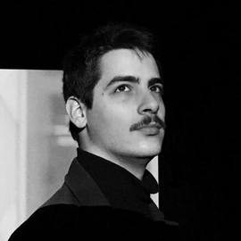



          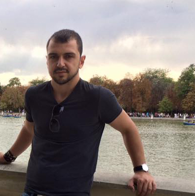



          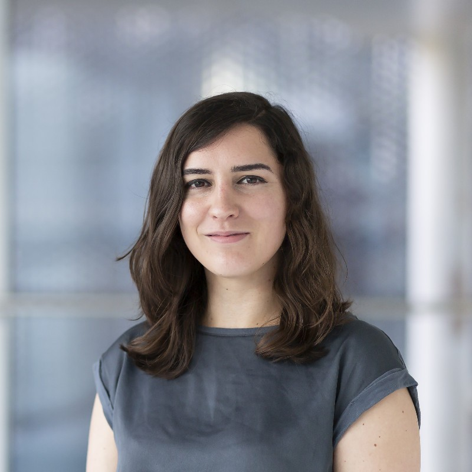



          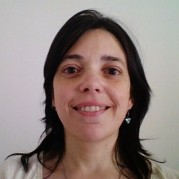



          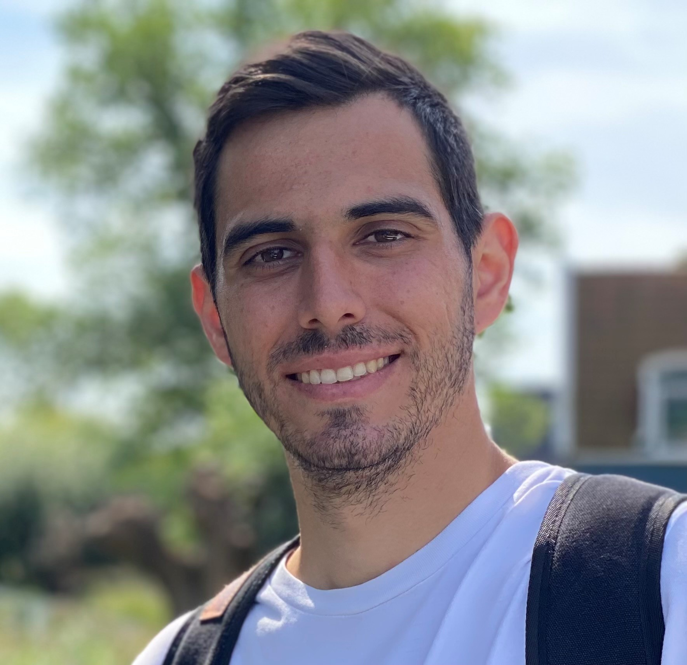







          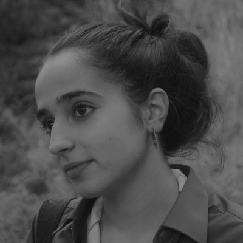



          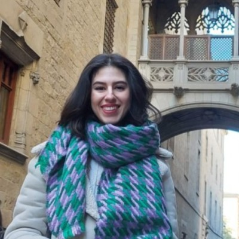



          



          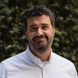




## Task 2




          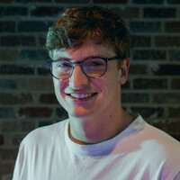



          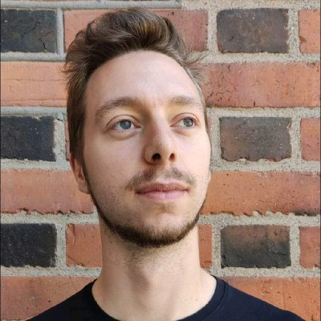



          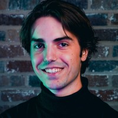




